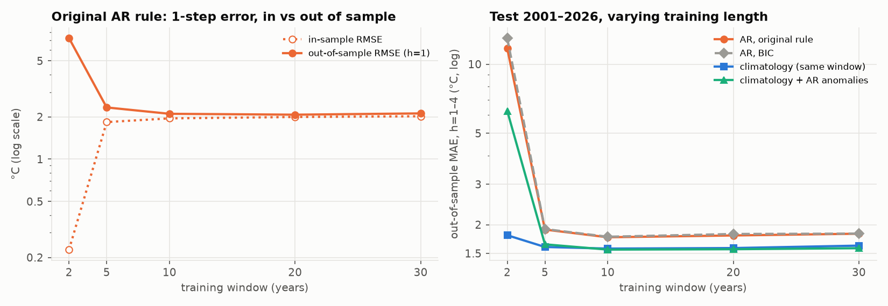

# Paris monthly temperature forecasting: re-evaluating an overfit course project

In a 2025 course project, my team forecast Paris monthly maximum temperatures for
Jan–Apr 2025 from 24 months of data. We picked a 9-lag autoregression out of 4,095
lag subsets because it had an adjusted R² of 0.9997. This repository redoes that
work properly and asks:

1. **Was the data right?** Which station is the course file from, and what were the
   real Jan–Apr 2025 values? (The assignment and our code used different ones.)
2. **Was the model any good?** How does the original selection rule perform out of
   sample, on many years instead of four months?
3. **With enough data**, does the rule still overfit, and can simple baselines beat it?

## Data

Météo-France *Données climatologiques de base – mensuelles* (Licence Ouverte v2.0),
station **Paris-Montsouris** (`75114001`), field **`TX`** = monthly mean of daily
maximum temperature. Snapshot downloaded 2026-11-10: 922 complete months,
1950-01 … 2026-10. Details, URLs and checksums are in [`data/README.md`](data/README.md).

- The course file `data2.csv` matches Montsouris `TX` exactly (24/24 values).
- Official Jan–Apr 2025: **7.5 / 8.6 / 14.6 / 20.0 °C**, same as the assignment PDF.
  The values later hard-coded in the original code (8 / 10 / 14 / 18) match no Paris
  station, and using them reverses the ranking of methods on those four months.

## Methods

- **Reproduction** of the original Q12–Q17 (linear trend; exhaustive search over lag
  subsets with "max adjusted R², all slopes p < 0.05"; recursive forecast), with tests.
- **Replay** of the original protocol for every year 1980–2026: train on the previous
  24 months, forecast Jan–Apr.
- **Rolling-origin backtest**, 310 monthly origins (2000-12 … 2026-09), horizons
  1–4 months, 30-year training window refitted every December. Compared:
  seasonal naive, 30-year climatology, lag-subset AR chosen by the original rule /
  adjusted R² / AIC / BIC / time-series CV, climatology + AR on anomalies, and
  SARIMA(1,0,0)(0,1,1)₁₂ (fixed in advance, not tuned on the test period).
  95% intervals from a 12-month block bootstrap.
- **Training-length sweep**: the same backtest with 2/5/10/20/30-year windows.
- A **leakage test** corrupts all data after a cutoff (+100 °C) and requires every
  earlier forecast to stay bit-for-bit identical.

## Results

All numbers below are produced by `make all` (see [`results/summary.md`](results/summary.md)).

**Original protocol replayed on 47 years (1980–2026, Jan–Apr, 188 forecasts)**

| Method | MAE (°C) | RMSE (°C) | Median AE (°C) |
|---|---|---|---|
| Original 9/10-lag AR, 12 training rows | 27.52 | 115.25 | 4.80 |
| 30-year climatology | 1.76 | 2.18 | 1.56 |
| Mean of the same month, last 2 years | 1.97 | 2.49 | 1.65 |
| Seasonal naive (same month last year) | 2.30 | 2.95 | 1.95 |

The original rule beat climatology in 3 of 47 years (1989, 2009, 2025); 46 of its 47
fits were explosive (largest AR root modulus > 1). Its median in-sample RMSE was
0.041 °C. On pure white noise, the same rule finds an "all p < 0.05" model in 17 of
20 series.

**Rolling-origin backtest 2001–2026, 30-year window (MAE, °C)**

| Method | h=1 | h=2 | h=3 | h=4 |
|---|---|---|---|---|
| Climatology + AR on anomalies | **1.521** | **1.583** | **1.595** | 1.620 |
| SARIMA(1,0,0)(0,1,1)₁₂ | 1.529 | 1.590 | 1.599 | **1.605** |
| 30-year climatology | 1.619 | 1.620 | 1.622 | 1.624 |
| Lag-subset AR, time-series CV | 1.648 | 1.816 | 1.829 | 1.848 |
| Lag-subset AR, original rule | 1.692 | 1.845 | 1.876 | 1.897 |
| Lag-subset AR, adjusted R² / AIC / BIC | 1.686–1.692 | 1.851–1.855 | 1.880–1.881 | 1.900–1.903 |
| Seasonal naive | 2.120 | 2.124 | 2.126 | 2.133 |

- With 30 years of data the original rule no longer overfits much (1-step RMSE
  2.019 in sample vs 2.116 out of sample), and the selection criterion barely matters.
- It still loses to climatology: significantly at h = 2–4 (e.g. h = 2: +0.225 °C,
  95% CI [0.116, 0.342]), not significantly at h = 1. Modelling raw temperature with
  lags 11–12 imports last year's random anomalies; after removing the seasonal mean,
  the lag-12 autocorrelation is −0.045.
- Only the two seasonal models beat climatology, and only one month ahead
  (−0.098 °C [−0.133, −0.019] and −0.089 °C [−0.123, −0.010]).
- Every method is biased cold (climatology: −0.84 °C), consistent with warming.



*Left: the original rule's 1-step error in sample vs out of sample as the training
window grows (0.227 vs 7.259 °C with 2 years, 2.019 vs 2.116 °C with 30 years).
Right: out-of-sample MAE over the same 2001–2026 test period.*

Other figures: [data](results/fig1_data.png) ·
[2025 ex-post](results/fig2_expost_2025.png) ·
[replay 1980–2026](results/fig3_replay_original_protocol.png) ·
[MAE by horizon](results/fig4_rolling_mae_by_horizon.png).

## Limitations

- One station and one variable; conclusions are specific to Paris-Montsouris `TX`.
- Jan–Apr 2025 is only four points; differences there are not meaningful.
- Overlapping forecasts give correlated errors; the block bootstrap is an approximation.
- The test period has a warming trend; trend-aware climatologies were not tested.
- SARIMA orders were fixed a priori; other specifications might do better. The CV
  criterion targets 1-step error only. Direct multi-step forecasting was not tested.
- Official 2025–2026 values have quality code 1 (validated) and could still be revised.
- The origin of the values 8 / 10 / 14 / 18 in the original code remains unknown.

## Reproduce

Python 3.11, dependencies pinned in `requirements.txt`.

```bash
python3 -m venv .venv && .venv/bin/pip install -r requirements.txt
```

```bash
make all     # all tables, figures and results/summary.md (~2 min, offline)
```

```bash
make test    # reproduction of the original numbers + no-look-ahead tests (~7 s)
```

```bash
make data    # optional: re-download Météo-France files and re-run the data checks
```

The walkthrough notebook (`notebooks/walkthrough.ipynb`) needs Jupyter
(`.venv/bin/pip install jupyterlab`). A Chinese tutorial with exercises and interview
notes is in [`TUTORIAL.md`](TUTORIAL.md).

| Path | Content |
|---|---|
| `src/data.py` | download / load data |
| `src/ar.py` | lag matrix, subset search, AIC/BIC/CV selection, recursive forecast |
| `src/models.py` | all forecasting methods (`fit` / `forecast` interface) |
| `src/original.py` | reproduction of the 2025 project |
| `src/evaluate.py` | metrics, rolling-origin backtest, replay, block bootstrap |
| `src/run_all.py` | runs everything, writes `results/` |
| `tests/` | reproduction, data facts, leakage tests |

## Acknowledgements

This started as the ISEP IF1205 *Science et traitement des données* course project
(May–June 2025) by **Yuefan LIU, Mouzheng LI and Lianghong LI**. Original repository:
[petitlang/Projet_ACP](https://github.com/petitlang/Projet_ACP); `data/original/data2.csv`
is copied from it unchanged (commit `9da990f`).

New in the 2026 rework: verification of the data and ground truth against Météo-France,
the clean reimplementation in `src/`, tests, the 1980–2026 replay, the rolling-origin
backtest with baselines and seasonal models, the training-length sweep, and the tutorial.
The rework was done with the help of an AI coding assistant; every number in this README
is produced by the code in this repository.

Data: © Météo-France, *Données climatologiques de base – mensuelles*, Licence Ouverte v2.0.
